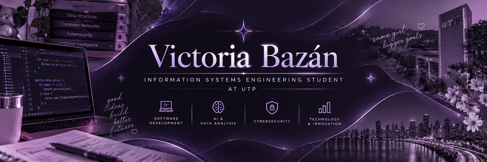

  

# Hi, I'm Victoria Bazán! 👋💜

**Information Systems Engineering Student**  
Universidad Tecnológica de Panamá (UTP) 🇵🇦

*Interested in software development, cybersecurity, artificial intelligence, and information systems.*

**🌐 English** · [🇵🇦 Leer en español](README.es.md)

---

## 👩‍💻 About me

I'm studying **Information Systems Engineering (Ingeniería de Sistemas de Información Gerencial)** at the **Universidad Tecnológica de Panamá**. I enjoy understanding how technology supports organizations, solves practical problems, and improves processes.

My academic projects have given me experience with programming, interface design, data analysis, numerical methods, and collaborative development. I'm especially interested in exploring **cybersecurity, AI, and software engineering** as I continue learning.

## 🛠️ Technologies & tools

**Programming**

**Development & collaboration**

**Design, data & electronics**

## 🚀 Featured projects

### 📦 [IlcaPoint — Inventory Management System](https://github.com/MasterFx04/IlkaPoint-App)
**C# · .NET · Frontend Development · Team Project**

Inventory management application developed as a team project. I independently designed and implemented the following frontend sections:

**My individual contributions (fully developed by me):**
- Developed the main dashboard interface.
- Built the inventory overview screen.
- Created the add-product interface.
- Developed the product-update interface.

**[View team repository and documentation](https://github.com/MasterFx04/IlkaPoint-App)**

### 🌡️ Numerical Methods with Arduino
**Arduino · Python · Sensors · LCD I2C**

Academic project combining sensor readings with numerical processing and visualization in Python, including Jacobi and Gauss–Seidel methods.

**Repository:** *Link coming soon*

### 📱 SphereQR
**Figma · UI/UX · Prototyping**

Mobile app prototype designed to simplify in-person professional contact sharing through QR codes and event-related features.

**Repository / prototype:** *Link coming soon*

### 🎮 [SpaceBirds — Space-Themed Game](https://github.com/MasterFx04/spacebirds-game-unity)
**Unity 2D · C# · Frontend & Game Design · Team Project**

Space-themed academic video game developed as a team project. I independently created and implemented the following game components:

**My individual contributions (fully developed by me):**
- Created the game characters.
- Developed the victory and defeat screens.
- Designed and developed all three game levels.

**[View team repository and documentation](https://github.com/MasterFx04/spacebirds-game-unity)**

> IlcaPoint and SpaceBirds are collaborative projects hosted under the team's repository owner. The components listed above were developed entirely by me; other project components were developed by my teammates, including Génesis, who also worked on frontend development.

## 🏆 Experience & achievements

### 🌍 World Robot Olympiad 2024 — Türkiye
**Future Innovators category**

Participated in a team project proposing a robotic solution to deliver medication in post-disaster scenarios. I contributed to the numerical work and project presentation, gaining experience in problem-solving, communication, and teamwork.

## 🎯 Areas of interest

- 🔐 Cybersecurity and fraud prevention
- 🤖 Artificial intelligence
- 💻 Software development
- 📊 Information systems and data analytics
- 🌐 Emerging technologies

## 🤝 Let's connect

I'm open to learning, collaborating on technology projects, and exploring new opportunities.

**GitHub:** [@VictoriaBazan](https://github.com/VictoriaBazan)

---

*Thanks for visiting my profile! 💜*

[🇵🇦 Versión en español](README.es.md)

